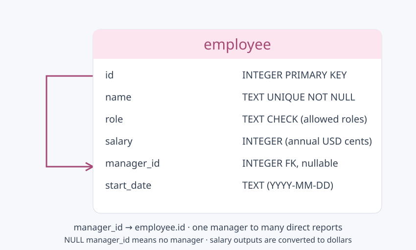

# AI + SQL Employee Analytics

A Python CLI turns plain-English questions into SQL, queries a SQLite database of 30 fictional employees, and returns natural-language answers through OpenRouter.



We compared three models using zero-shot and four-example single-domain few-shot prompts on ten questions: nine SQL questions and one unsupported promotion-history question.

| Model | Zero-shot SQL | Few-shot SQL | Total API cost |
|---|---|---|---|
| Gemini 3.1 Flash Lite | 9/9 | 9/9 | $0.007984 |
| Gemma 3 27B | 8/9 | 8/9 | $0.002089 |
| DeepSeek V3.2 | 9/9 | 9/9 | $0.006795 |

All models correctly declined the unsupported question. Gemma missed indirect reports in both modes. Few-shot prompting did not improve SQL accuracy in this run. All 60 observations cost **$0.01687** total; scores compare query results, not answer quality, and reflect this small dataset.

**[Full HTML results: scores, SQL, answers, and expected results](results/comparisons/initial/index.html)** — download and open in a browser to use the filters.

Run the app or a fresh comparison:

```sh
python3 -m employee_analytics.app
python3 -m employee_analytics.compare
```

Edit [models.py](employee_analytics/models.py) to add or remove models and [cases.py](employee_analytics/cases.py) to change questions. Each comparison saves a new HTML report and its raw results.

[Setup](docs/SETUP.md) · [Schema](docs/diagrams/schema.svg) · [Submission notes](docs/SUBMISSION.md) · [Original assignment](docs/assignment.md)
